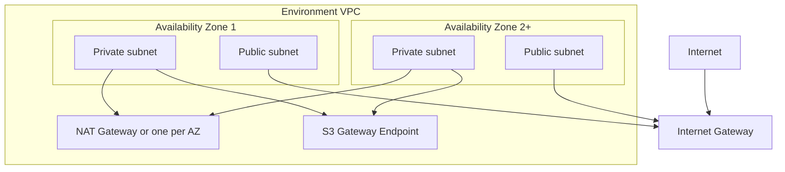

# AWS EKS Platform with Terraform

A hands-on AWS platform project built with reusable Terraform modules and isolated environment roots. The current implementation establishes the network and IAM foundations; it does not yet create an EKS control plane or worker nodes.

## Current implementation

- VPC with public and private subnets across two or three discovered availability zones
- Internet gateway, public routing, private routing, and configurable NAT gateway topology
- S3 gateway VPC endpoint for private route tables
- Dedicated worker-node security group
- Separate EKS control-plane and EC2 node IAM roles
- S3 state bucket bootstrap configuration with versioning, encryption, public access blocking, HTTPS-only access, and Terraform S3 lockfile support
- Separate `dev`, `qa`, `stage`, and `prod` roots with distinct state key examples

The EKS cluster, managed node groups, EKS add-ons/workload identity, ECR, and monitoring are the next implementation stages. See [the roadmap](docs/operations.md).

## Architecture



Dev, QA, and stage examples use a single NAT gateway to limit fixed cost. Production uses one NAT gateway per AZ for availability. A single NAT gateway is a cost-saving choice and a single-AZ dependency. Review [cost notes](docs/cost.md) before planning.

## Repository layout

```text
bootstrap/s3-state/       Secure remote-state bucket foundation
modules/                  Reusable VPC, endpoint, security-group and IAM modules
environments/{dev,qa,stage,prod}/
                          Independent environment roots and backend configs
examples/                 Safe backend and input examples
docs/                     Module, security, cost, CI and operations guides
.github/workflows/        Formatting, validation and optional plan workflow
```

Each environment has its own Terraform state key. Do not point multiple roots at the same state object. CIDR examples are distinct; confirm they do not overlap with VPCs, VPNs, peering, or corporate networks.

## Prerequisites

- Terraform `>= 1.10.0, < 2.0.0`
- AWS CLI with a short-lived identity, such as AWS IAM Identity Center
- An AWS account and region with the required service quotas

The AWS provider uses the standard credential chain. Do not store access keys in Terraform files or GitHub. State, local plans, variable files, and backend settings are ignored by Git; example files contain placeholders only.

## Local workflow

1. Review `environments/dev/terraform.tfvars.example` and choose a non-overlapping CIDR and a currently supported Kubernetes version.
2. Copy it to the ignored local file `terraform.tfvars` and set values appropriate for your AWS account.
3. Provision the state bucket separately from `bootstrap/s3-state` after reviewing its plan and cost. Do not point the bootstrap root at the bucket it is creating.
4. Copy `backend.hcl.example` to the ignored local `backend.hcl`; set the actual bucket name and environment key.
5. From the environment root, initialize with the backend config, then run `terraform fmt -check -recursive` from the repository root, `terraform validate`, and `terraform plan -var-file=terraform.tfvars`.
6. Review the full plan, AWS account identity, replacements, and destroys before any deployment decision.

No GitHub workflow runs `terraform apply`. The optional CI plan is skipped until repository variables and an AWS OIDC role are configured. See [CI setup](docs/ci.md).

## Documentation

- [Module guide](docs/modules.md)
- [Security and repository hygiene](docs/security.md)
- [Cost and availability](docs/cost.md)
- [Operations and roadmap](docs/operations.md)
- [GitHub Actions setup](docs/ci.md)

This is an educational starting point. Review account guardrails, provider/service requirements, security controls, and pricing before using it for real workloads.
